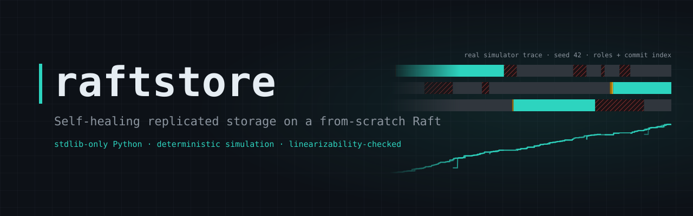
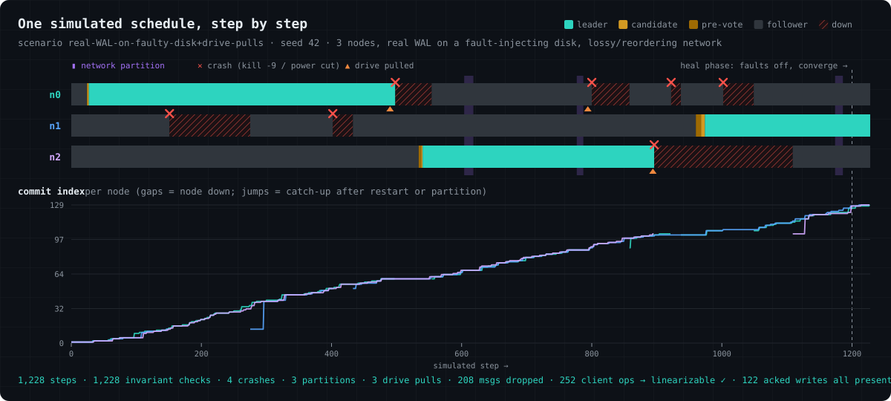
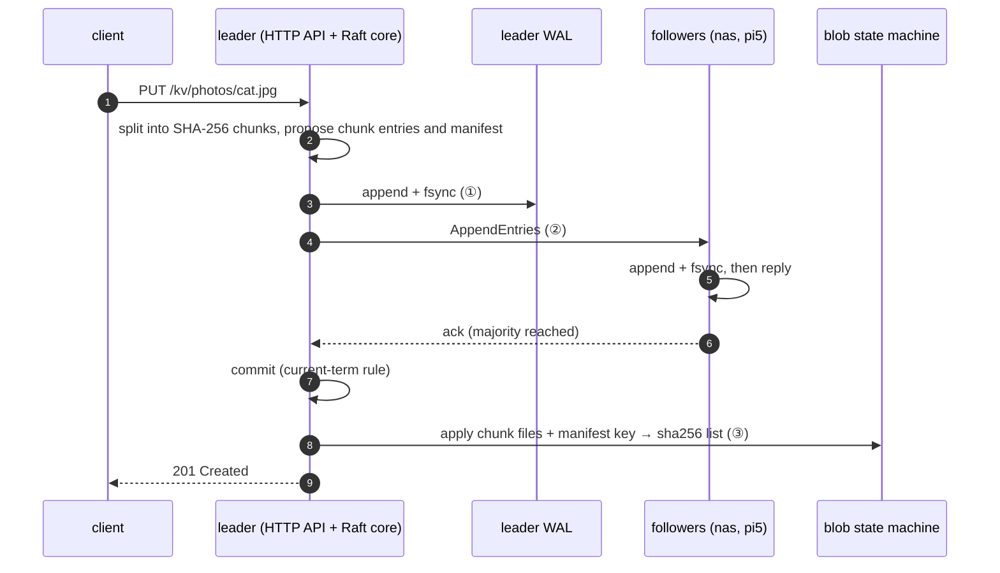
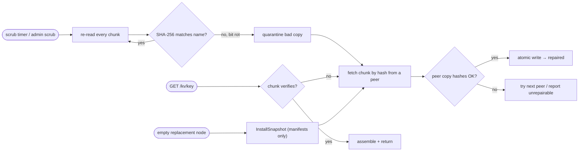
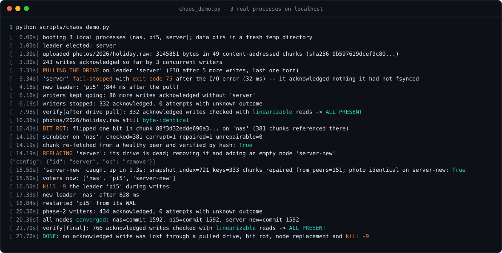

<p align="center">
  
</p>

<p align="center">
  <a href="https://github.com/coopersimpson101-debug/raftstore/actions/workflows/ci.yml"></a>
  <a href="LICENSE"></a>
  
  
</p>

**Self-healing replicated storage for a home lab, on a Raft implementation written from scratch and
tested like a database.** Put a NAS, a Raspberry Pi 5 and a server PC in one cluster: every file is split
into SHA-256-addressed chunks, replicated through Raft to a majority, and fsynced before you get an
acknowledgement. Pull a drive mid-write, let a bit rot, or replace a dead node, and no acknowledged
write is lost.

<p align="center">
  <a href="#quickstart">Quickstart</a> ·
  <a href="#architecture">Architecture</a> ·
  <a href="#testing-by-the-numbers">Testing</a> ·
  <a href="#status">Status</a> ·
  <a href="docs/raft.md">Raft notes</a> ·
  <a href="docs/storage.md">Storage notes</a> ·
  <a href="docs/api.md">HTTP API</a> ·
  <a href="docs/operations.md">Operations</a>
</p>

<p align="center">
  
  <br>
  <sub>A real trace from the deterministic simulator (seed 42, scenario <code>real-WAL-on-faulty-disk+drive-pulls</code>):
  leaders come and go through crashes, drive pulls and partitions, and the commit index keeps advancing.
  Regenerate with <code>python scripts/make_figures.py</code>.</sub>
</p>

## Highlights

- **Raft written by hand, no Raft library.** It is a deterministic, I/O-free state machine
  (`step(msg) → Ready{persist, send, apply}`) with PreVote, CheckQuorum, fast log backtracking, snapshots and
  InstallSnapshot, single-server membership changes, ReadIndex and lease reads, and leadership transfer.
- **Zero runtime dependencies.** Python 3.11+ stdlib only: asyncio TCP/TLS transport, HTTP API, mutual TLS.
- **The storage layer is also written by hand.** A CRC-framed WAL with torn-write truncation, atomic
  snapshots, a content-addressed chunk store, a background scrubber and peer repair.
- **2,100 randomized schedules / 6.4 M simulated steps**, with Raft's safety invariants checked after
  every single step (deep CI sweep, 300 seeds × 7 scenarios).
- **Every client history is checked for linearizability** with a Wing–Gong/Knossos-style checker, in the simulator *and* on
  real processes that get `kill -9`'d.
- **3,716 storage crash points.** The suite cuts power before and after every fsync, pulls the drive
  inside every write, and tears the WAL tail at every byte.
- **Fail-stop on EIO.** After a failed fsync the node exits (code 75) rather than ever acknowledging
  unsynced data.

## Quickstart

```sh
git clone https://github.com/coopersimpson101-debug/raftstore && cd raftstore
python scripts/chaos_demo.py                 # 3 local processes: pull a drive, rot a bit, replace a node, kill -9
pip install pytest hypothesis && python -m pytest -q -m "not cluster"   # the fast part of the suite
python scripts/make_figures.py               # regenerate the README figures from a real simulator run
```

<details>
<summary><b>Docker (one host) and real-machine usage</b></summary>

With Docker on one host (the CLI runs inside the containers, where the node names resolve):

```sh
docker compose -f deploy/docker-compose.yml up --build -d
docker compose -f deploy/docker-compose.yml exec nas sh -c   'echo hello > /tmp/h && python -m raftstore --url http://nas:8080,http://pi5:8080,http://server:8080 put greeting /tmp/h'
docker compose -f deploy/docker-compose.yml exec pi5 python -m raftstore --url http://pi5:8080 get greeting
```

On the real machines (see [docs/operations.md](docs/operations.md)):

```sh
python3 -m raftstore serve --config /etc/raftstore/node.json          # via deploy/systemd/raftstore.service
export RAFTSTORE_URLS=https://10.0.0.10:8080,https://10.0.0.11:8080,https://10.0.0.12:8080
python3 -m raftstore put photos/cat.jpg ./cat.jpg
python3 -m raftstore get photos/cat.jpg -o /tmp/cat.jpg
python3 -m raftstore status --all
```

API reference: [docs/api.md](docs/api.md).
</details>

## Status

| | |
|---|---|
| ✅ **Done & tested here** | Raft core, WAL/snapshots/chunks, scrubber + peer repair, node replacement, mutual TLS (localhost), HTTP API and CLI. Full suite plus the 3-process `kill -9` cluster test pass on Windows 10 / Python 3.12 and in CI on Ubuntu (Python 3.11–3.13). |
| 🧪 **Simulated only** | Power loss on all nodes at once, drives pulled at every write, message loss/duplication/reordering, partitions, and membership changes under faults. These run in the deterministic simulator on a fault-injecting filesystem, not on physical disks. |
| ⏳ **Needs hardware** | Bring-up on the actual NAS / Pi 5 / server, LAN benchmarks, physically pulling the leader's drive, real power cuts, bit rot on a real disk, TLS across the LAN, multi-day soak test, and Wi-Fi tuning of `tick_ms` / `election_ticks`. See [Hardware validation](#hardware-validation). |

## Architecture

The one rule that matters: a node **persists and fsyncs before it sends anything**, and acknowledges a
client only after the entry is committed on a majority and applied. The Raft core cannot break this
rule. It has no way to send; it can only return a `Ready` that the runtime processes in that order.



Self-healing runs continuously beside replication:



<details>
<summary><b>Component diagram (one node)</b></summary>

```
                 clients:  raftstore CLI · curl · scripts/bench.py
                                     │  HTTP(S)  PUT/GET/DELETE /kv/<key>, /status, /admin/*
     ┌───────────────────────────────┼─────────────────────────────────────────────┐
     │ node "server" (leader)        ▼                                             │
     │  ┌────────────────────────────────────────────┐   ┌──────────────────────┐  │
     │  │ HTTP API (asyncio)                         │   │ Scrubber             │  │
     │  │  PUT: split → chunk entries + manifest      │   │ re-hash every chunk, │  │
     │  │  GET: ReadIndex → verify chunks → assemble  │   │ quarantine + repair  │  │
     │  └───────────────┬────────────────────────────┘   └─────────┬────────────┘  │
     │      propose /   │ read_index                    peer repair │ GET /internal/chunk/<sha>
     │                  ▼                                           │              │
     │  ┌────────────────────────────────────────────┐              │              │
     │  │ Raft core  (pure, deterministic)           │◄── tick() ── asyncio timer   │
     │  │  step(msg) → Ready{persist, send, apply}   │                             │
     │  └──────┬───────────────┬───────────────┬─────┘                             │
     │  ① persist + fsync   ② send          ③ apply                                │
     │         ▼               ▼               ▼                                   │
     │  ┌─────────────┐  ┌───────────┐  ┌──────────────────────────────────────┐   │
     │  │ WAL (CRC32) │  │ TCP/TLS   │  │ Blob state machine                   │   │
     │  │ + snapshots │  │ transport │  │  manifests: key → [sha256…]          │   │
     │  └─────────────┘  └─────┬─────┘  │  chunk store: chunks/<aa>/<sha256>   │   │
     │                         │        └──────────────────────────────────────┘   │
     └─────────────────────────┼───────────────────────────────────────────────────┘
                 Raft RPCs     │   (append / vote / pre-vote / snapshot / timeout-now)
              ┌────────────────┴────────────────┐
              ▼                                 ▼
   node "nas"  (follower)              node "pi5"  (follower)
   same components, own disk           same components, own disk
```
</details>

| path | what |
|---|---|
| `raftstore/raft/core.py` | the Raft state machine (≈700 lines) |
| `raftstore/storage/wal.py`, `raftlog.py` | WAL format + recovery, snapshot files, `DiskStorage` |
| `raftstore/storage/chunks.py`, `statemachine.py` | content-addressed chunks, replicated blob/KV state machine |
| `raftstore/storage/fs.py` | filesystem interface: `RealFS`, `FaultInjectingFS`, simulated `FaultyFS` |
| `raftstore/node.py`, `transport.py`, `httpd.py`, `codec.py` | the server: asyncio TCP/TLS transport, HTTP API, scrubber, repair |
| `raftstore/sim/cluster.py` | deterministic cluster simulator |
| `raftstore/check/` | safety-invariant checker, linearizability checker |
| `raftstore/cli.py`, `client.py` | `raftstore` command line and client library |

## Testing, by the numbers

Measured on one Windows 10 development machine (Python 3.12, three local processes / in-process
simulation) and in GitHub Actions. **Nothing here was measured on the NAS, Pi 5 or server.**

| suite | what it does | result |
|---|---|---|
| default `pytest -q` | 187 tests: core scenarios, simulator, storage faults, linearizability, in-process nodes, mutual TLS, real 3-process `kill -9` cluster | **187 passed** in 127 s |
| simulator, default seeds | 235 randomized schedules × 3000 steps (716,757 simulated steps incl. heal phase, invariants checked after each; 111,228 client ops; 2,754 crashes, 2,792 partitions, 552 random drive pulls, 183,224 dropped + 49,872 duplicated messages) | all invariants held, every history linearizable, no acknowledged write lost |
| simulator, 300 seeds/scenario | **2,100 schedules** (300 per scenario × 7): 6,423,903 steps, 934,611 client ops, 25,177 crashes, 25,076 partitions, 4,386 drive pulls, 1.68 M dropped messages | **7/7 passed** in 13 min 53 s: zero invariant violations, 2,100/2,100 histories linearizable, 454,005 acknowledged writes verified present on every member |
| storage crash points | power cut before/after every fsync, drive pulled inside every write, torn WAL tail at every byte: 3,716 distinct crash points | all recovered without losing an acknowledged entry |
| real processes | 4 client threads, leader `kill -9`'d twice, restarted; wall-clock history checked | latest run: 1,229 ops (595 acked writes, 4 indeterminate, 630 reads) → **linearizable**, replicas identical |

```sh
python -m pytest -q                                               # whole suite (needs pytest + hypothesis)
RAFTSTORE_SIM_SEEDS=300 python -m pytest -q tests/test_simulation.py   # deeper sweep (CI runs this on main)
```

How the simulator works, what the checkers check, the mutation tests that prove they catch real bugs,
and the six bugs they found during development: [docs/testing.md](docs/testing.md).

### Chaos demo

`python scripts/chaos_demo.py` boots three real processes named nas / pi5 / server on localhost, then pulls
the leader's drive, flips a bit in a chunk, replaces a dead node, and `kill -9`s the next leader. CI runs it on
every push.

<p align="center">
  
</p>

<sub>Rendered from [docs/chaos_demo_output.txt](docs/chaos_demo_output.txt), the captured output of a real run on the
development machine. Timings and counts differ from run to run.</sub>

### Local micro-benchmark (`python scripts/bench.py --local`)

Three processes on one Windows 10 laptop-class machine, loopback network, fsync on (NTFS). This is only a baseline
for the real hardware runs.

```
seq-1024               n=300   size=1024     threads=1   ops/s=   137.4  MB/s=   0.14  p50=   6.0ms p99=  27.9ms
conc8-1024             n=296   size=1024     threads=8   ops/s=   250.0  MB/s=   0.26  p50=  31.0ms p99=  57.3ms
seq-1048576            n=30    size=1048576  threads=1   ops/s=    21.6  MB/s=  22.62  p50=  38.8ms p99= 156.7ms
get-linearizable       n=300   size=1024     threads=1   ops/s=   546.1  MB/s=   0.56  p50=   1.4ms p99=  18.6ms
```

## Design notes

<details>
<summary><b>Raft, explained (as implemented here)</b></summary>

Full detail with code pointers: [docs/raft.md](docs/raft.md).

**Elections.** A follower that hears nothing from a leader for a *randomized* election timeout becomes a
candidate, increments the term and asks for votes; a majority makes a leader. Each node votes at most
once per term (the vote is fsynced before the reply) and only for candidates whose log is at least as
up-to-date as its own. Two additions keep a home network calm. With **PreVote**, a node first asks whether
it *would* win, without bumping its term, so a Pi that drops off Wi-Fi does not come back with a huge
term and depose the leader. With **CheckQuorum**, a leader that cannot reach a majority steps down, and
followers that have a live leader ignore vote requests.

**Log replication.** The leader appends client commands to its log and sends them with the index and
term of the preceding entry. A follower accepts only if it has that preceding entry, truncating any
conflicting *uncommitted* suffix. On rejection it returns a conflict hint (term + first index of that
term) so the leader skips a whole term per round trip instead of one entry.

**Commit rules.** An entry is committed once a majority stores it **and** it belongs to the leader's
current term; older entries commit indirectly with it (Raft §5.4.2, the "Figure 8" trap, which a test
reproduces). New leaders append a no-op to get a current-term entry committed quickly. Clients are
acknowledged only after commit + apply.

**Safety argument.** One vote per term + majority intersection ⇒ one leader per term. The prev-entry
consistency check ⇒ logs that agree on an (index, term) agree on the whole prefix. The up-to-date voting
rule + majority intersection ⇒ every committed entry is in every later leader's log. Hence all nodes
apply the same commands in the same order. Each of these four properties is *checked* after every step
of every simulated schedule.

**Snapshots.** Applied state is periodically snapshotted and the log prefix discarded (WAL rewritten
atomically). A follower too far behind receives InstallSnapshot. Snapshots carry only manifests; chunk
bytes are re-fetched from peers by hash. The same mechanism re-populates a replacement
node.

**Membership changes.** One server at a time (any old and new majority overlap), effective on append,
at most one uncommitted change, and only after the leader committed an entry in its own term. Founding
membership is log entry 1, so joiners learn the full history.

**Reads.** The default is **ReadIndex**. The leader notes its commit index, proves it is still leader with one
heartbeat round to a majority, waits until applied ≥ that index, then reads. That makes reads linearizable without
writing to the log. Optional **lease** mode skips the round trip while a recent quorum heartbeat makes
another leader impossible (assumes bounded clock drift). **Leadership transfer** moves the leader off a
machine before maintenance.
</details>

<details>
<summary><b>Storage layer design</b></summary>

Full detail: [docs/storage.md](docs/storage.md).

* **WAL**: `len | crc32 | type | payload` records; one batch and one fsync per Raft `Ready`, written in
  the order *reset → entries → hard state*, so every torn prefix is a legal pre-reply state. On
  recovery, an invalid tail with nothing valid after it is a torn write and gets truncated. An invalid record with
  valid records after it means acknowledged data is corrupt, so the node refuses to start (fail-stop) and
  should be replaced.
* **Snapshots**: `temp file → fsync → rename → fsync(dir)`, CRC-checked, newest two kept; the WAL is
  re-based onto the snapshot if a crash landed between the two.
* **Chunks**: files named by their SHA-256, written atomically. Every read is verified, so a node never
  returns rotten data; it repairs from a peer instead.
* **Scrubber**: re-reads every chunk at a configurable rate, detects bit rot by hash mismatch,
  quarantines the bad copy and repairs from a peer. **GC** of orphaned chunks is a replicated command.
* **Fail-stop on I/O errors**: any EIO from the disk stops the node (exit code 75). After a failed fsync
  the page cache can no longer be trusted, so the only safe option is to never acknowledge anything again.
</details>

<details>
<summary><b>Fault model</b></summary>

Full table: [docs/fault-model.md](docs/fault-model.md). With 3 voters raftstore tolerates any **one**
node failing in any of these ways: crash / `kill -9`, power loss (even of all nodes at once, where only
acknowledged data must survive), a drive pulled mid-write, a dead drive (node replacement), bit rot in
chunks or snapshots, message loss/duplication/reordering/delay, and partitions. It does **not** tolerate
Byzantine nodes, drives that lie about fsync, or losing a majority of drives; lease reads additionally
assume bounded clock drift.
</details>

## Hardware validation

**No results from the real NAS, Pi 5 or server PC exist in this repository yet.** The exact procedure
(install, bring-up, LAN benchmark, physically pulling the leader's drive during writes, power cuts, bit
rot on a real disk, Pi-specific checks) and empty result tables are in
[docs/operations.md → Hardware validation](docs/operations.md#hardware-validation--todo-for-the-author).

| test | nas | pi5 | server |
|---|---|---|---|
| bring-up / joined cluster | ⏳ | ⏳ | ⏳ |
| `bench.py` seq PUT 1 KiB p50 (ms) | ⏳ | ⏳ | ⏳ |
| `bench.py` seq PUT 1 MiB MB/s | ⏳ | ⏳ | ⏳ |
| drive pulled mid-write: acked writes missing | ⏳ | ⏳ | ⏳ |
| power cut: acked writes missing | ⏳ | ⏳ | ⏳ |
| scrub: corrupt chunk found + repaired | ⏳ | ⏳ | ⏳ |

Other open items: an end-to-end run with TLS across the LAN (TLS is tested on localhost only), a long
soak test (days) with the scrubber on spinning disks, and tuning `tick_ms`/`election_ticks` for Wi-Fi
if the Pi is not wired.

## Deploy

`deploy/` contains:

- example configs for the three machines (`deploy/config/{nas,pi5,server}.json`, 10.0.0.10–12 placeholders, mutual TLS) and a replacement-node config
- systemd units; the service refuses to restart-loop after a fail-stop (exit code 75)
- a scrub timer
- a Dockerfile and a docker-compose file for a single-host trial

Certificate generation: [deploy/tls/README.md](deploy/tls/README.md). Operations guide:
[docs/operations.md](docs/operations.md).

## Contributing · Security · Citation

See [CONTRIBUTING.md](CONTRIBUTING.md) and [SECURITY.md](SECURITY.md). If you use raftstore in academic
work, [CITATION.cff](CITATION.cff) has the citation metadata.

## License

MIT. See [LICENSE](LICENSE).
